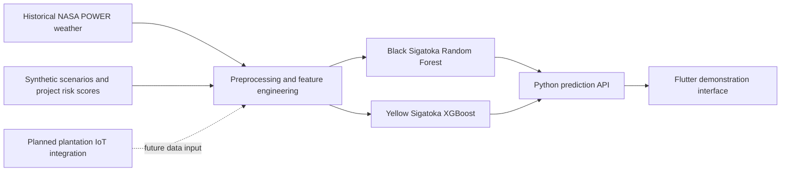

# Environmental Disease Risk Prediction for Cavendish Banana Plantations
**Research title:** A Multimodal Edge-AI Framework for Early Disease Risk Prediction and Severity-Based Resource Optimization in Cavendish Banana Plantations in Sri Lanka

| Project information | Details |
|---|---|
| Research project ID | J26-IT-408 |
| Component | Component 02 — Environmental Disease Risk Prediction |
| Module | IT4010 Research Project |
| Institution | Sri Lanka Institute of Information Technology (SLIIT) |
| Academic year | 2026 |

## Executive summary
Visible leaf symptoms are useful for disease identification, but they appear after infection has begun and can delay scouting or management decisions. Environmental conditions such as temperature, humidity, rainfall and leaf wetness can indicate when conditions may be favourable to some banana diseases. This component explores how those conditions can be converted into disease-specific risk scores that could support early awareness and plantation resource planning.

The repository contains NASA POWER-derived historical weather data, project-generated synthetic risk scenarios, feature-preparation notebooks, Random Forest and XGBoost experiments, saved models, a local Python prediction API and a Flutter demonstration interface. The API currently serves a Black Sigatoka Random Forest and a Yellow Sigatoka XGBoost model. Their scores reproduce project-defined mathematical targets; they are not confirmed disease observations, calibrated infection probabilities or field-validated predictions. Data ingestion from plantation IoT sensors, the Cordana Leaf Spot and BBTV models, and independent field validation remain future work for the overall research.

## Research problem and objectives
Banana disease assessment based only on visible symptoms may provide limited lead time for targeted scouting. This component investigates whether available environmental history can be organized into useful, interpretable risk indicators for Cavendish banana plantations in Sri Lanka. The current repository is a prototype because its training targets are synthetic and its historical weather is gridded rather than measured in a plantation.

The component objectives are to:

- Prepare historical and scenario-based environmental data for Black and Yellow Sigatoka risk experiments.
- Derive wetness and rolling-window features while keeping estimated values distinct from measurements.
- Train and compare Random Forest and XGBoost regressors against project-defined risk scores.
- Evaluate selected models on separate validation and held-out synthetic test partitions.
- Expose saved model predictions through a local API and Flutter demonstration.
- Document the evidence and data needed for future sensor integration and independent field validation.

## Diseases covered
| Disease | Type / mechanism | Environmental factors represented here | Model or approach | Status |
|---|---|---|---|---|
| Black Sigatoka | Fungal leaf disease | Air temperature, estimated wet/dry state and consecutive wetness duration are the selected model features. | Random Forest selected for the API; XGBoost was also evaluated. | Implemented prototype; targets are synthetic environmental scores. |
| Yellow Sigatoka | Fungal leaf disease | 14-day mean temperature, estimated wet hours in the previous 14 days and consecutive wetness duration. | XGBoost selected for the API; Random Forest was also evaluated. | Implemented prototype; targets are project-defined suitability scores. |
| Cordana Leaf Spot | Fungal leaf spot | No Cordana-specific dataset, feature set or risk method was found in the repository. | None found. | Planned; not implemented. |
| Banana Bunchy Top Virus (BBTV) | Vector-transmitted viral disease | No BBTV-specific environmental or vector data pipeline was found. It should not be treated as a fungal leaf-wetness model. | None found. | Planned; not implemented. |

## Proposed solution and system architecture
Historical NASA POWER weather and synthetic scenarios are prepared by disease-specific notebooks and dataset builders. Selected features are passed to separate saved models; the Python API validates inputs, returns bounded scores, risk levels and alert details, and the Flutter demonstration can display those outputs. The repository does not implement live weather or plantation sensor ingestion. Forecast examples use fixed or reconstructed simulated weather.



The dotted IoT connection is planned, not implemented. The model artifacts, request features and API routes are documented in [`api/model_api.py`](api/model_api.py). No separate architecture image or relevant app screenshot was found, so this README uses the implementation-based diagram above and does not embed illustrative assets as screenshots.

## Environmental parameters
Availability varies between historical NASA-derived records and constructed scenarios. A feature present in a CSV is not necessarily an input to either saved model.

| Parameter | Repository use and status |
|---|---|
| Air temperature | NASA-derived historical value. `air_temp_c` is a Black model input; Yellow uses `mean_temp_previous_14d_c`. |
| Relative humidity | Present in weather datasets and used by wetness estimation; not a selected model input. Scenario values may be constructed. |
| Rainfall | Present in historical data and used by wetness estimation; not a selected model input. Some scenario values are constructed. |
| Leaf wetness | `estimated_leaf_wet` is a derived binary proxy, not a direct sensor measurement. It is a Black model input. |
| Consecutive wetness duration | Derived from consecutive estimated wet hours; input to both saved models. |
| Previous-window wetness | Previous 24/72-hour summaries occur in datasets; Yellow also uses estimated wet hours in the previous 14 days. |
| Dew point | Present or calculated in weather files and used by one wetness proxy; not a selected model input. |
| Wind speed | Present in the Black full-feature historical dataset and donor-derived in some scenarios; not a selected model input. |
| Solar radiation | Present in historical data and used in the Yellow wetness proxy; some scenario values are constructed. Not a selected model input. |
| Canopy temperature | A Black full-feature column exists but is unavailable/blank; it is not measured or modeled. |
| Soil moisture | No field or implementation was found. |

The Black documentation describes its historical wetness proxy as RH >= 98% or hourly rainfall >= 1 mm. Yellow methodology and the API describe RH >= 95%, or dew-point depression <= 1.5 C with solar radiation < 0.15 in the source units, or rainfall >= 0.5 mm/hour. Both are project estimation rules and are uncalibrated against leaf-wetness sensors. See the [Black dataset notes](datasets/black_sigatoka/BS_FULL_FEATURE_README.md) and [Yellow methodology notes](datasets/yellow_sigatoka/YS_METHODS_README.md).

## Dataset sources and preparation
### Source and dataset sizes
Dataset documentation identifies hourly NASA POWER point data for Bingiriya, Sri Lanka (7.59832 N, 79.93734 E), covering 2022–2024 in UTC. NASA POWER provides gridded estimates, not plantation sensor observations. Historical rows include weather-derived proxy scores; these are not observations of disease occurrence.

| Dataset | Rows | Description |
|---|---:|---|
| [Black historical NASA dataset](datasets/black_sigatoka/BS_FULL_FEATURE_HISTORICAL_NASA.csv) | 26,304 | Hourly historical weather and project-derived wetness/risk fields. Categories: 24,990 No Risk, 1,288 Low, 26 Moderate, 0 High. |
| [Black source-time train](datasets/black_sigatoka/revised_splits/BS_SOURCE_TIME_train.csv) | 4,501 | Synthetic scenarios linked to historical donor timestamps. |
| [Black source-time validation](datasets/black_sigatoka/revised_splits/BS_SOURCE_TIME_validation.csv) | 937 | Synthetic scenarios separated by donor time. |
| [Black source-time test](datasets/black_sigatoka/revised_splits/BS_SOURCE_TIME_test.csv) | 524 | Reserved synthetic scenarios; a 120-hour boundary purge is documented. |
| [Yellow historical NASA dataset](datasets/yellow_sigatoka/YS_NASA_HISTORICAL_2022_2024.csv) | 25,969 | Historical weather-derived features and heuristic suitability scores; first 335 warm-up rows are excluded. |
| [Yellow simulated train](datasets/yellow_sigatoka/YS_SIMULATED_train.csv) | 4,200 | 1,050 scenarios per project-defined category. |
| [Yellow simulated validation](datasets/yellow_sigatoka/YS_SIMULATED_validation.csv) | 900 | 225 scenarios per category. |
| [Yellow simulated test](datasets/yellow_sigatoka/YS_SIMULATED_test.csv) | 900 | 225 scenarios per category. |

### Features, targets and risk categories
The Black full-feature CSV has 25 columns covering scenario metadata, timestamps, air temperature, relative humidity, rainfall, dew point and dew-point depression, wind speed, solar radiation, estimated wetness, wetness duration, 24-hour summaries, canopy temperature, provenance, `risk_score` and `risk_level`. The selected model inputs are `air_temp_c`, `estimated_leaf_wet` and `consecutive_wetness_hours`.

The Yellow CSV has 32 columns, including weather and wetness values, 24-hour/72-hour/14-day summaries, rolling temperature and humidity means, suitability components, a favourable-condition flag, `risk_score`, `risk_level` and provenance fields. Its selected model inputs are `mean_temp_previous_14d_c`, `wet_hours_previous_14d` and `consecutive_wetness_hours`.

| Disease | Target | Project category boundaries |
|---|---|---|
| Black Sigatoka | `risk_score`, 0–100 | No Risk: score = 0; Low: 0 < score < 25; Moderate: 25 <= score < 75; High: 75 <= score <= 100. |
| Yellow Sigatoka | `risk_score`, 0–100 | No Risk: score < 5; Low: 5 <= score < 30; Moderate: 30 <= score < 65; High: 65 <= score <= 100. |

These are project-defined environmental indices and category thresholds, not empirical infection probabilities or observed severity levels. The Black synthetic scores were copied from a project-generated source whose original scoring generator is absent; its documentation describes a project adaptation of a temperature-dependent Weibull wet-spell response, not the cited paper's full method. Yellow scores use a project-designed heuristic informed by cited research; its coefficients and category thresholds are engineering choices, not a published equation.

### Splits and preprocessing
- Black training partitions use donor-time chronology: 2022–2023 for training, the first half of 2024 for validation and the second half for test, with a 120-hour purge near split boundaries. Counts are 4,501 / 937 / 524.
- Yellow synthetic partitions contain 4,200 / 900 / 900 rows and are balanced across four categories. Scenario IDs do not overlap, but underlying 336-hour NASA analogue windows may overlap.
- Preprocessing reports found the selected model inputs and target complete and finite; no imputation, scaling, shuffling or resampling was applied to the reported split workflows. Tree-based models were used.
- Synthetic Black humidity, rainfall, dew point and solar values are constructed or donor-derived. Yellow synthetic records are counterfactual weather analogues retaining one endpoint. They are not continuous measured plantation time series.
- Some unused columns are blank by design, including canopy temperature and certain rolling summaries for point scenarios. No soil moisture data were found.

Further details: [Black dataset/method notes](datasets/black_sigatoka/BS_FULL_FEATURE_README.md), [Black split and limitations report](datasets/black_sigatoka/FIXES_AND_LIMITATIONS.md), [Yellow method notes](datasets/yellow_sigatoka/YS_METHODS_README.md), and the disease-specific preprocessing reports under `reports/`.

## Machine learning methodology
Notebook workflows cover EDA, preprocessing, feature engineering, Random Forest, XGBoost and evaluation for each implemented disease. There is no single command-line training entry point. The saved models used by the API are a Black Random Forest and a Yellow XGBoost regressor.

### Black Sigatoka
The Random Forest and XGBoost experiments use `air_temp_c`, `estimated_leaf_wet` and `consecutive_wetness_hours` to regress `risk_score`. Model candidates were fitted on the 4,501-row training partition and selected using validation MAE, with RMSE as a tie-breaker. The Random Forest search report evaluated 54 predefined combinations. The final Random Forest (300 trees, unlimited depth, `min_samples_leaf=1`, `max_features=1.0`, random state 42) was selected over XGBoost based on validation metrics and is loaded by the API. The 524-row test split was reserved for final evaluation.

### Yellow Sigatoka
Random Forest and XGBoost use `mean_temp_previous_14d_c`, `wet_hours_previous_14d` and `consecutive_wetness_hours` to regress `risk_score`. The XGBoost candidates were compared on validation MAE; Model 4 was selected with 300 estimators, depth 5, learning rate 0.05, squared-error objective and random state 42. It had lower validation MAE than the evaluated Random Forest and is loaded by the API. The 900-row test partition was evaluated after model selection.

## Model comparison and experimental results
The validation and held-out test tables below correspond to different evaluation stages. Every score is measured against synthetic project-generated targets, not independent plantation disease observations.

### Validation comparison
| Disease | Candidate | Validation rows | MAE | RMSE | R2 | Category accuracy | Macro F1 |
|---|---|---:|---:|---:|---:|---:|---:|
| Black | Random Forest (selected) | 937 | 0.363315 | 0.754338 | 0.999614 | 0.994664 | 0.993559 |
| Black | XGBoost | 937 | 0.497516 | 0.882316 | 0.999472 | 0.899680 | 0.892817 |
| Yellow | Random Forest | 900 | 0.56401 | 1.01173 | 0.99892 | 0.9767 | 0.9767 |
| Yellow | XGBoost Model 4 (selected) | 900 | 0.50093 | 0.76876 | 0.99938 | 0.9833 | 0.9833 |

### Final held-out synthetic test results
| Disease and selected model | Test rows | MAE | RMSE | R2 | Category accuracy | Macro F1 |
|---|---:|---:|---:|---:|---:|---:|
| Black Random Forest | 524 | 0.298249 | 0.732781 | 0.999690 | 0.994275 | 0.991737 |
| Yellow XGBoost Model 4 | 900 | 0.54835 | 1.01473 | 0.99890 | 0.98667 | 0.98667 |

Black test category errors were 3 of 524; its confusion matrix (actual rows, predicted columns in No Risk / Low / Moderate / High order) was `[[132,0,0,0],[0,57,0,0],[0,2,109,1],[0,0,0,223]]`. Yellow had 12 category errors, all adjacent-category errors; its matrix was `[[222,3,0,0],[3,219,3,0],[0,2,223,0],[0,0,1,224]]`. Yellow had 20 raw test predictions outside 0–100; its category evaluation used a bounded copy. Black metrics use raw predictions for regression, as described in its report.

The selected models closely reproduce their synthetic targets on these splits. This agreement does not establish biological generalization or real-world disease-prediction accuracy. See the [Black final test report](reports/black_sigatoka/final_evaluation/Final_Test_Evaluation_Report.md) and [Yellow final test report](reports/yellow_sigatoka/final_evaluation/Final_Test_Evaluation_Report.md) for full details.

## Technology stack
| Technology | Use evidenced in the repository |
|---|---|
| Python | Dataset preparation, model workflows and local API. |
| Pandas, NumPy | Tabular data handling and numerical operations. |
| scikit-learn | Random Forest regression and evaluation utilities. |
| XGBoost | Gradient-boosted regression experiments and saved Yellow model. |
| Joblib | Saved and loaded model artifacts. |
| Matplotlib, Seaborn | Evaluation and exploratory visualizations. |
| Jupyter | EDA, preprocessing, training and evaluation notebooks. |
| Python `http.server` | Local `ThreadingHTTPServer` JSON API; it is not FastAPI. |
| Flutter / Dart | Demonstration application and API client. |
| NASA POWER | Source of gridded historical weather estimates. |

Python package versions are pinned in [`requirements.txt`](requirements.txt). Flutter packages are declared in [`Research-Project-main/pubspec.yaml`](Research-Project-main/pubspec.yaml). Git branch and remote details are not available in this workspace.

## Repository structure
```text
.
|-- api/                         # Local model API and API documentation
|-- datasets/
|   |-- black_sigatoka/          # Historical/synthetic data, splits and method notes
|   `-- yellow_sigatoka/         # Historical/synthetic data and method notes
|-- forecast_demo/               # Fixed simulated 336-hour history and 168-hour future
|-- Models/                      # Disease-specific Random Forest/XGBoost artifacts
|-- notebooks/                   # EDA, preprocessing, engineering, training and evaluation
|-- reports/                     # Dataset reviews, metrics, prediction tables and figures
|-- Research-Project-main/       # Flutter demonstration application
|   |-- assets/images/           # UI artwork and illustrative assets (not screenshots)
|   `-- lib/                     # UI and API client
|-- src/                         # Black preprocessing and data validation utilities
|-- requirements.txt             # Pinned Python dependencies
`-- README.md
```

Generated build output, virtual environments, caches and logs are omitted. Dataset and model files are summarized rather than listing every artifact.

## Installation and setup
### Prerequisites
- Python compatible with the pinned dependencies in `requirements.txt`.
- Flutter and Dart only if running the demonstration interface.
- The repository files, including the saved models under `Models/`.

No repository URL is available here, so cloning is not documented. From the project root after obtaining the repository, create and activate a virtual environment.

**Windows PowerShell**
```powershell
python -m venv .venv
.venv\Scripts\Activate.ps1
python -m pip install --upgrade pip
pip install -r requirements.txt
```

**macOS / Linux**
```bash
python3 -m venv .venv
source .venv/bin/activate
python -m pip install --upgrade pip
pip install -r requirements.txt
```

Start Jupyter from the repository root so notebook-relative paths resolve:

```bash
jupyter lab
```

No API credentials or separate configuration file are required. The API loads the saved Black Random Forest and Yellow XGBoost artifacts from their repository paths.

## Running the models and API
### Notebook training and evaluation
Open the disease-specific notebooks in `notebooks/` from the project root. The repository includes `black_sigatoka_preprocessing.ipynb`, `black_sigatoka_feature_engineering.ipynb`, `black_sigatoka_random_forest.ipynb`, `black_sigatoka_xgboost.ipynb`, `black_sigatoka_final_evaluation.ipynb`, and corresponding Yellow Sigatoka notebooks. `dataset_exploration.ipynb` and `yellow_sigatoka_eda.ipynb` support exploration; `environmental_risk_forecast_demo.ipynb` documents the forecast demonstration. Follow each workflow's cells and reports; there is no unified training CLI. Use the existing saved models directly through the API if retraining is not intended.

### Start the local API
From the repository root, start one of these commands:

```powershell
python -u api\model_api.py
```

```bash
python -u api/model_api.py
```

The server listens at `http://127.0.0.1:8765`. Implemented routes are:

| Method | Route | Purpose |
|---|---|---|
| GET | `/api/health` | Health response. |
| GET | `/api/forecast-demo` | Fixed simulated forecast demonstration. |
| POST | `/api/predict-current` | Predict current Black and Yellow environmental risk from supplied features. |
| POST | `/api/forecast-scenario` | Simulated forecast with scenario adjustments. |
| POST | `/api/forecast-from-inputs` | Forecast using submitted summaries, a reconstructed history and fixed simulated future. |

### Example: current risk prediction
The request below follows the exact nested feature names expected by `predict_current()` in [`api/model_api.py`](api/model_api.py). This example response was generated by calling that function with the shown input and the saved models.

```bash
curl -X POST http://127.0.0.1:8765/api/predict-current \\
  -H "Content-Type: application/json" \\
  -d '{
    "black": {
      "air_temp_c": 27,
      "estimated_leaf_wet": 1,
      "consecutive_wetness_hours": 12
    },
    "yellow": {
      "mean_temp_previous_14d_c": 27,
      "wet_hours_previous_14d": 96,
      "consecutive_wetness_hours": 12
    }
  }'
```

```json
{
  "black": {
    "score": 15.61,
    "level": "Low",
    "alert_severity": "info",
    "alert_required": false,
    "alert_message": "Slightly favourable conditions. Continue monitoring."
  },
  "yellow": {
    "score": 33.08,
    "level": "Moderate",
    "alert_severity": "warning",
    "alert_required": true,
    "alert_message": "Moderately favourable conditions. Increase monitoring and consider field inspection."
  },
  "note": "Scores reproduce synthetic environmental-risk labels; they are not disease diagnoses."
}
```

The API validates numeric and finite inputs, ranges, wet/dry consistency, and matching consecutive-wetness duration for the two disease inputs. It bounds model scores to 0–100 before assigning risk categories. This response is a synthetic-score prediction, not a diagnosis.

For the Flutter demonstration, use a second terminal and run from `Research-Project-main/`:

```bash
flutter pub get
flutter run
```

The client base URL is `http://127.0.0.1:8765`. Device or browser networking may require that address to be reachable from the runtime environment. The repository does not configure live sensors or a weather provider.

## Expected outputs and screenshots
- Current prediction responses contain `score`, `level`, `alert_severity`, `alert_required` and `alert_message` for each implemented disease, plus a limitation note.
- Forecast routes return daily simulated risk outputs and recommendation text. Their weather is fixed or reconstructed, not a live forecast.
- Existing evaluation artifacts include metrics, prediction CSVs, confusion matrices and plots in the disease-specific `reports/` folders.
- The Flutter assets are UI illustrations and artwork. No relevant application screenshot files were found, so no screenshot is embedded.

## PP1 development progress
### Completed implementation
- Historical NASA-derived weather datasets and disease-specific synthetic scenario splits.
- Black and Yellow feature preparation, Random Forest and XGBoost experiments, saved model artifacts and evaluation reports.
- Held-out synthetic test evaluations for the selected Black Random Forest and Yellow XGBoost models.
- Local Python API endpoints for current risk and simulated forecast workflows.
- Flutter demonstration interface and API client integration for current risk and forecast views.

### Partially implemented / prototype
- Wetness estimates, historical proxy-risk scores and both disease risk models are preliminary and lack validation against sensors and confirmed disease observations.
- The seven-day forecast workflow uses fixed or mathematically reconstructed environmental histories and simulated future data.
- Black synthetic partitions are donor-time separated, but source-time grouping does not make the scenarios field observations. Yellow scenario analogue windows may overlap across partitions.
- The Flutter application is a demonstration interface; there is no verified end-to-end integration with external disease detection or resource-optimization components.

### Planned development
- Cordana Leaf Spot and BBTV-specific data and models.
- Plantation IoT sensor ingestion and calibrated wetness measurements.
- Real-time weather input, prospective evaluation and field validation.
- Edge-device implementation and latency, memory and power benchmarking.
- Verified integration with visual detection and resource optimization components.

## Contribution to the overall research project
Component 02 contributes the environmental-risk stream to the broader multimodal research by converting weather-derived features into disease-specific risk indicators. In a future validated system, an environmental alert could complement a visual leaf-disease detection component: the environmental model could indicate favourable conditions, while image analysis could assess visible symptoms. Combining those signals could help prioritize scouting and resource allocation.

The research context identifies Component 01 as visual banana leaf disease detection, but this repository does not provide its model implementation or demonstrate data-level integration with it. The Flutter application contains screens for forecasting and resource-related concepts, but those screens do not establish integration with other research components or a validated resource-optimization algorithm. Component interaction described here is therefore a proposed contribution, not a completed system capability.

## Limitations
- **Synthetic targets:** Model metrics measure agreement with mathematical environmental-risk labels, not confirmed infections, disease severity or calibrated probabilities.
- **Weather source:** NASA POWER provides gridded estimates rather than plantation-level sensor observations; its environmental distribution differs from the synthetic scenarios.
- **Wetness proxy:** Estimated wetness is based on project rules and is not calibrated against leaf-wetness sensors.
- **Label provenance:** The original Black score generator is unavailable, and some repeated feature combinations have small target differences. Yellow thresholds and coefficients are project choices.
- **Split independence:** Black source-time separation and a 120-hour purge reduce known donor-time overlap but do not remove shared synthetic assumptions or all possible temporal dependence. Yellow analogue windows can overlap across splits.
- **Historical evaluation:** Black historical proxy scores include no High category rows. Historical proxy categories are not observed disease outcomes.
- **Incomplete inputs:** Some scenario weather values are constructed or blank; canopy temperature is unavailable and soil moisture is absent.
- **Forecast and deployment:** Forecast histories/futures are fixed or reconstructed simulations. No live weather provider, connected IoT system, edge device benchmark or external validation is evidenced.
- **Disease scope:** Cordana and BBTV have no implemented datasets or models in this repository.

## Future improvements
1. Collect plantation-level weather and calibrated leaf-wetness measurements alongside independently confirmed disease onset and severity observations.
2. Reassess the proxy and synthetic label-generation methods, then evaluate on site/year-separated field data and compare against transparent rule-based baselines.
3. Establish time-available model inputs before integrating live readings; test for leakage and quantify uncertainty and class-wise errors.
4. Develop separate Cordana and BBTV approaches using suitable disease-specific data, including vector-related evidence for BBTV.
5. Integrate verified weather forecasts and sensor feeds, then conduct prospective testing and benchmark on target edge hardware.
6. Validate interfaces between environmental scoring, visual disease detection and resource planning before describing the system as integrated.

## Research references and data provenance
The following references and source are listed in the repository's dataset methodology files:

1. NASA POWER Data Access Viewer, hourly point data: [power.larc.nasa.gov](https://power.larc.nasa.gov/).
2. Bebber (2019), cited in the Black dataset notes, DOI: [10.1098/rstb.2018.0269](https://doi.org/10.1098/rstb.2018.0269). The project uses an adaptation, not the complete method in the paper.
3. Jacome and Schuh (1992), cited in the Black dataset notes, DOI: [10.1094/Phyto-82-515](https://doi.org/10.1094/Phyto-82-515).
4. Bonfim Junior et al. (2024), cited in the Yellow dataset notes, DOI: [10.52945/rac.v37i3.1862](https://doi.org/10.52945/rac.v37i3.1862).
5. Pérez and Fernández (1978), cited for laboratory germination limits in the Yellow dataset notes; FAO AGRIS record: [647245ed2c1d629bc9796815](https://agris.fao.org/search/en/providers/122535/records/647245ed2c1d629bc9796815).

These sources inform data provenance and project heuristics; they do not validate the synthetic labels or models for Sri Lankan plantation outcomes. For methodology and caveats, see the [Black dataset notes](datasets/black_sigatoka/BS_FULL_FEATURE_README.md), [Black split and limitations notes](datasets/black_sigatoka/FIXES_AND_LIMITATIONS.md) and [Yellow methodology notes](datasets/yellow_sigatoka/YS_METHODS_README.md).

## Acknowledgements
This work is completed as part of SLIIT's IT4010 Research Project and contributes to the broader research on Cavendish banana plantation monitoring.
